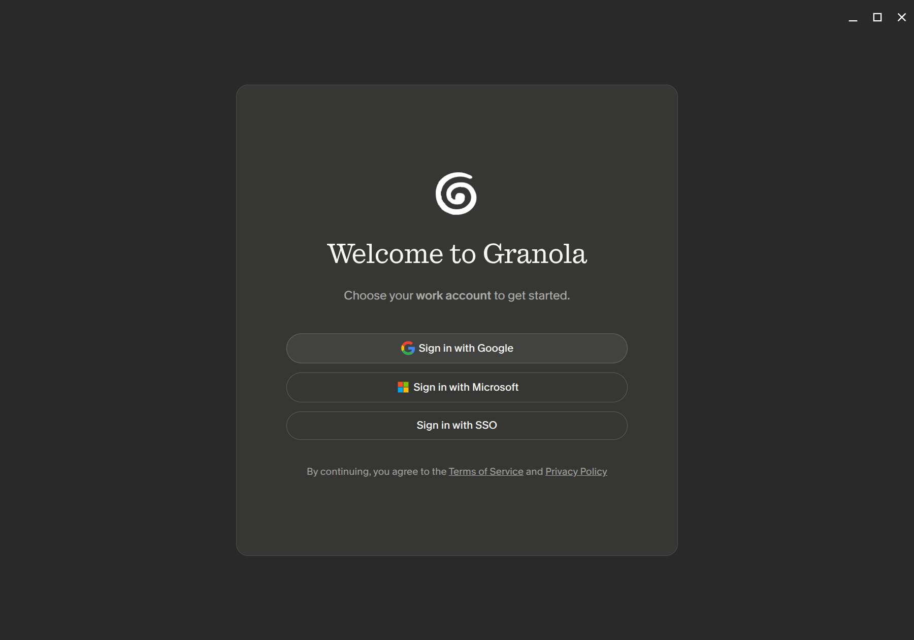

# Granola on Linux

[Granola](https://www.granola.ai) only ships for macOS and Windows. It is an Electron app though, so the macOS `.dmg` already holds all of the app's JavaScript, which runs anywhere. It is just attached to a macOS runtime. This repo swaps in the Linux runtime and fixes what breaks. You get a real Linux app. No Wine, no VM, no emulation.

## Run it

1. Download the `.dmg` from [granola.ai/download](https://www.granola.ai/download)
2. Install what you need: `sudo apt install g++-11 nodejs npm python3 curl make`
3. Run `./granola-linux.sh "Granola - AI Notepad.dmg"`
4. Open Granola from your app menu and sign in

That is it. The script installs to `~/Applications/granola`, adds a desktop entry, registers the `granola://` sign-in handler, and tests the build before it tells you it worked. Run `./uninstall.sh` to undo it.

Set `INSTALL_DIR=` to install somewhere else. You need x86-64 and g++ 11 or newer. Tested on Pop!\_OS (Ubuntu 20.04 base, glibc 2.32) with Granola 7.452.1 and Electron 42.7.0.

## What works

| | |
|---|---|
| ✅ | Notes, editor, sync, AI features, and search. The core app. |
| ✅ | Sign-in with Google, Microsoft, or SSO |
| ✅ | Encrypted local database that survives restarts |
| ✅ | Microphone recording |
| ✅ | System audio capture through Chromium's output loopback, so the other side of a call is transcribed too. |
| ❌ | Apple Calendar (EventKit). Google and Microsoft calendars still work, since those run on the server. |
| ❌ | Global hotkeys |
| ❌ | Auto-update. Run the script again with a newer `.dmg`. |

## Build it yourself

If you would rather not run the script, the conversion takes six steps:

1. Extract the `.dmg` with a modern `7zz`. The `p7zip` in most distros cannot read its LZFSE compression.
2. Read the Electron version out of `Electron Framework.framework/.../Info.plist`, then download that exact Linux build.
3. Unzip the Linux runtime into your install folder and delete `resources/default_app.asar`.
4. Copy `app.asar`, `app.asar.unpacked`, and `icons/` from the bundle into the runtime's `resources/`. Skip every Mac binary, since they all sit behind `darwin` checks.
5. Patch `app.asar`: make the platform string report `Windows` (Granola's API returns a 500 error for `platform=linux`, so sign-in fails without this) and switch the Linux display-media fallback from a silent fake loopback source to Chromium's real `loopback` capture.
6. Rebuild `better-sqlite3-multiple-ciphers` from the C++ source inside `app.asar.unpacked` using g++ 11 or newer. Granola's version adds an `updateHook()` that no public build has.

Four of those six fail with errors that do not point at the real cause. `granola-linux.sh` has the exact commands, with comments explaining each one.

## Notes

- Nothing here gets around licensing or sign-in. You use your own account and the app talks to Granola's real servers. The only patches are a platform label their API refuses to accept and a Linux audio source selection that Granola gets wrong.
- Granola's code belongs to Granola. Do not commit `app.asar` or the `.dmg`. The `.gitignore` covers both.
- The script asks for sudo once to configure Electron's setuid sandbox helper (`chrome-sandbox`, root-owned mode 4755). Distributions that restrict unprivileged user namespaces, such as Ubuntu 23.10+ with AppArmor, need this or Electron refuses to start. If you skip the sudo step, the launcher falls back to `--no-sandbox`.
- System audio is captured from the default output monitor, so its level follows that monitor in your audio mixer.
- Running the script again is safe. It wipes and rebuilds the install folder and leaves your notes in `~/.config/Granola` alone.
- `./uninstall.sh --purge` also removes the local notes cache and login.
